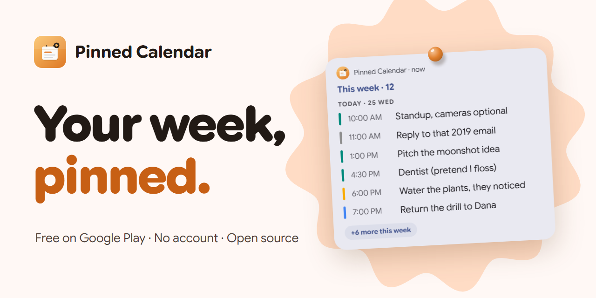
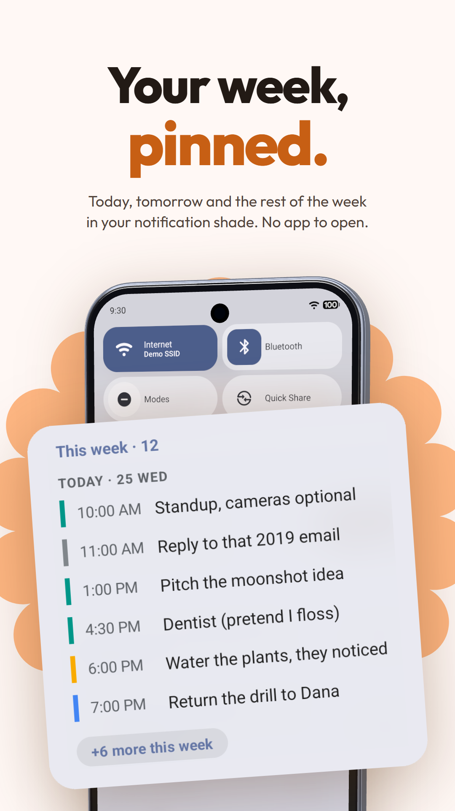
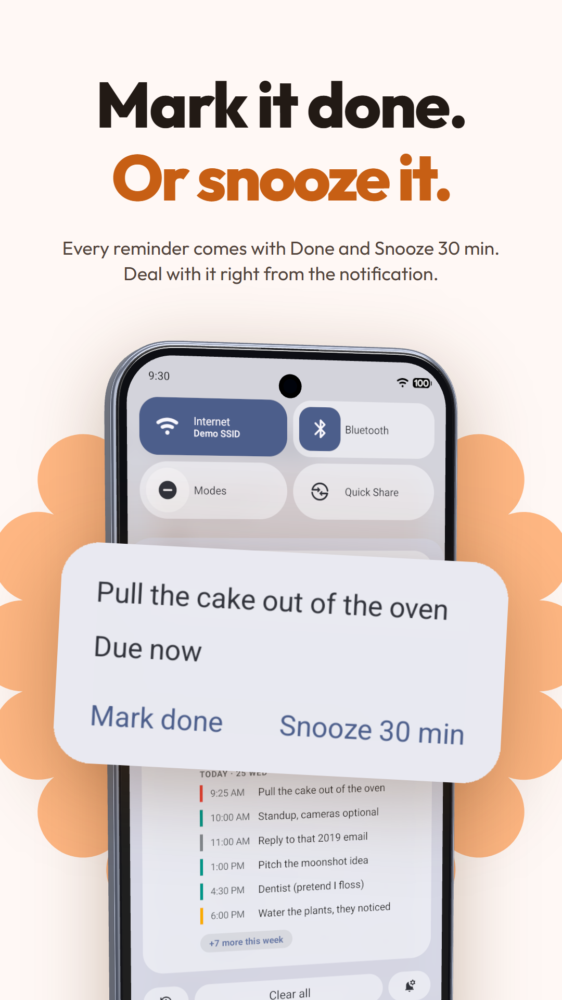
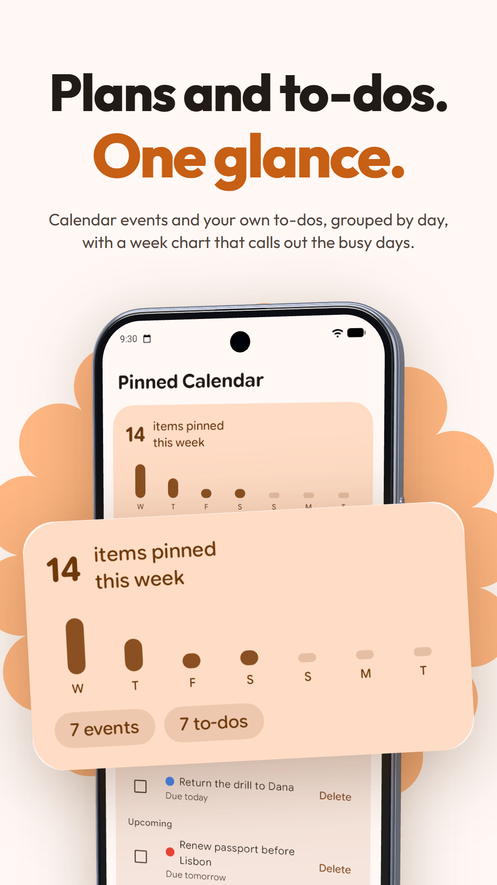
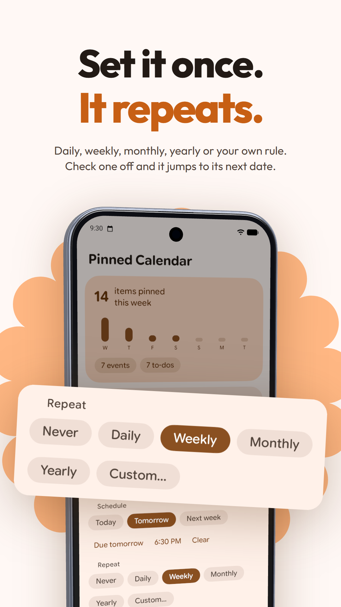
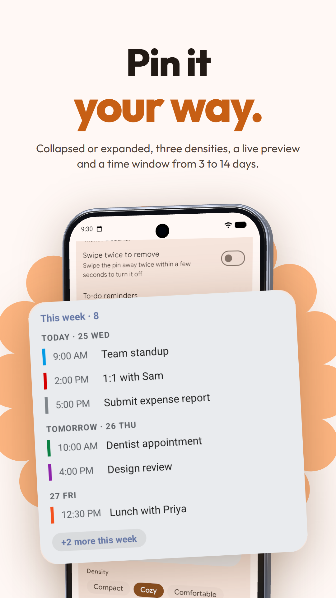
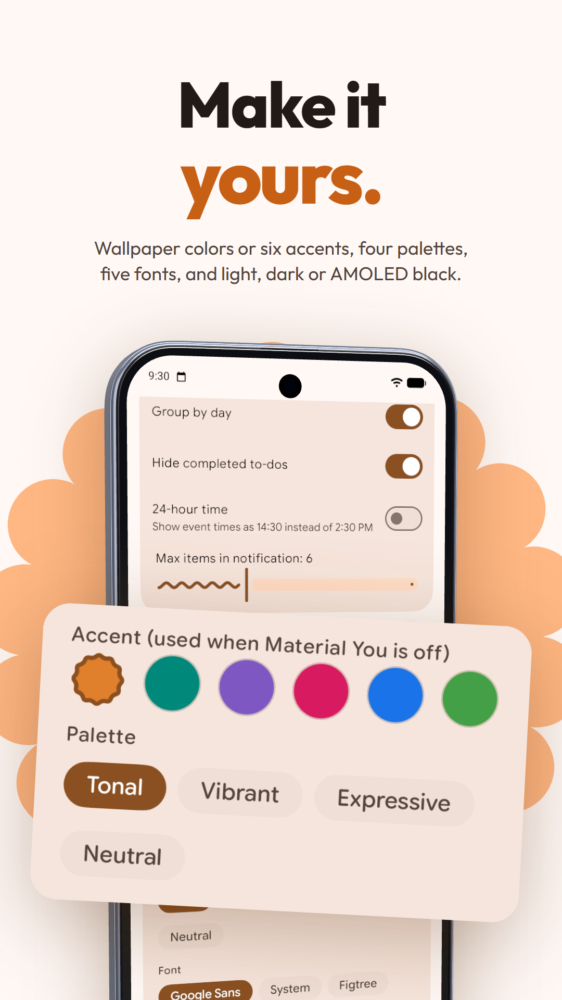
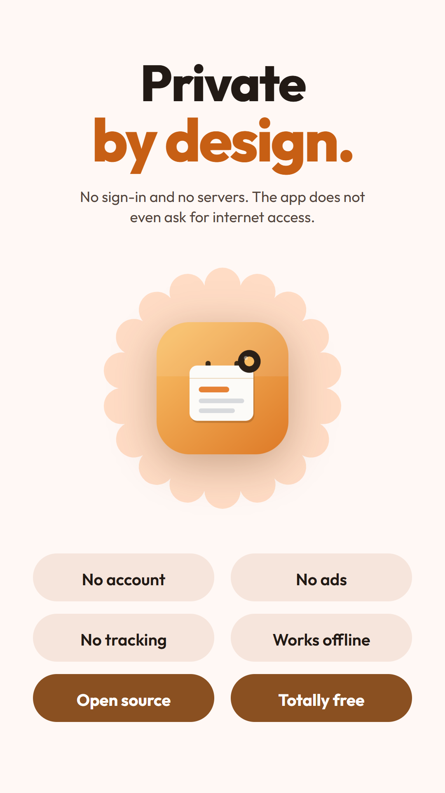
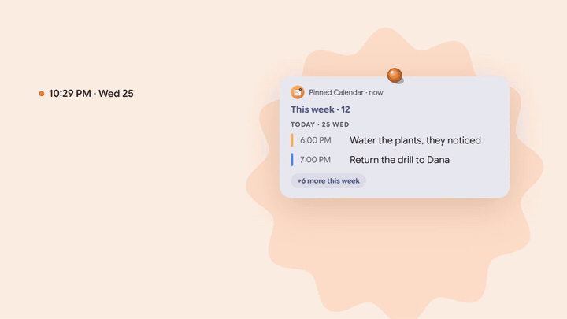

<a name="readme-top"></a>

<div align="center">



Your week's calendar events and to-dos in one persistent Android notification.<br/>
No sign-in, no cloud, no internet permission. Your schedule never leaves the phone.

**[Website][website-link]** · **[Google Play][play-link]** · [Releases][releases-link] · [Privacy][privacy-link] · [Report an issue][issues-link]

<!-- SHIELDS GROUP -->

[![][release-shield]][releases-link]
[![][play-shield]][play-link]
[![][platform-shield]][platform-link]
[![][minsdk-shield]][minsdk-link]<br/>
[![][kotlin-shield]][kotlin-link]
[![][compose-shield]][compose-link]
[![][ci-shield]][ci-link]
[![][downloads-shield]][releases-link]
[![][license-shield]][license-link]

<a href="https://play.google.com/store/apps/details?id=dev.ahnafnafee.pinnedcalendar"></a>

<table>
  <tr>
    <td></td>
    <td></td>
    <td></td>
    <td></td>
  </tr>
  <tr>
    <td></td>
    <td></td>
    <td></td>
    <td align="center"><b><a href="#launch-film">Watch the<br/>launch film</a></b></td>
  </tr>
</table>

</div>

> \[!NOTE]
> Pinned Calendar reads the calendars already synced on your device through Android's Calendar Provider. There is no Google sign-in, no OAuth, and no `INTERNET` permission: everything stays on the phone.

<details>
<summary><kbd>Table of contents</kbd></summary>

- [Features](#features)
- [Launch film](#launch-film)
- [Installation](#installation)
- [Configuration](#configuration)
- [How it works](#how-it-works)
- [Privacy and permissions](#privacy-and-permissions)
- [Tech stack](#tech-stack)
- [Building from source](#building-from-source)
- [Roadmap](#roadmap)
- [Contributing](#contributing)
- [License](#license)
- [Acknowledgements](#acknowledgements)

</details>

## Features

### An agenda that stays pinned

An ongoing notification keeps this week's events and to-dos at the top of the shade. It heals itself: swipe it away by accident and it posts again, and it comes back after reboots and app updates. Set its priority to Top, Normal or Silent. Top keeps it above your everyday notifications without popping up or making a sound, and an optional swipe-twice gesture dismisses it for good. At local midnight the pin refreshes on its own, so Today and Tomorrow are right when you wake up, even after Doze has held back background work all night.

### To-dos that remind and repeat

Quick tasks you add in the app merge into the same agenda and carry forward day to day until you complete or delete them. Tap a to-do to rename it, schedule it with quick chips (today, tomorrow, next week) or any date and time, give it a priority flag whose color rides into the pin, and attach notes. Repeat it daily, weekly, monthly or yearly, or build your own rule with intervals, weekdays and an ending by date or count. Checking off a recurring to-do moves it to its next date and keeps month ends, leap years and local time intact. Reminders are on by default: each one alerts when an occurrence comes due, without touching the pin, and offers **Mark done** and **Snooze 30 min** right in the notification.

### The pin, your way

A live preview in Settings renders the real notification, collapsed or expanded, while you tune it: density presets (Compact, Cozy, Comfortable or Custom sliders), how many rows show before it expands, day grouping with Today, Tomorrow and weekday sections, and the heading toggles. Tap an event row to open it in Google Calendar, or tap anywhere else on the pin to open the app.

### Material You theming

Wallpaper-based dynamic color, six accent seeds, four palette styles, AMOLED black, five fonts, and light, dark or system themes, plus a launcher icon that adapts to the theme and accent.

### 15 languages

The whole app, reminders included, is translated into English, Arabic, Bengali, Chinese (Simplified), French, German, Hindi, Indonesian, Italian, Japanese, Korean, Portuguese, Spanish, Turkish and Vietnamese. Arabic gets a right-to-left layout, and Android 13 and later list these languages in the system app-language picker.

### Private by design

No accounts, no ads, no trackers, no cloud and no `INTERNET` permission. The app reads your device calendars, keeps each calendar's color, and sends nothing anywhere.

### Light on battery

There is no foreground service. Background refresh runs on WorkManager, a ContentObserver updates the pin as soon as a calendar changes, and one alarm at local midnight rolls the day over. An optional battery-optimization exemption helps on aggressive OEMs.

<div align="right">

[![][back-to-top]](#readme-top)

</div>

## Launch film

<div align="center">



</div>

A 36-second film follows one day on the pinned card, from the first swipe at 9:30 AM to the page turning at midnight. The clip above is the midnight turn. The film's source, its treatment and a one-command build are in [`film/`](film/): run `sh film/build.sh` to render `pinned-calendar-launch.mp4` (1920x1080, 60 fps). The picture is made in code from real app captures, and the score is synthesized.

<div align="right">

[![][back-to-top]](#readme-top)

</div>

## Installation

The easiest way is Google Play:

<a href="https://play.google.com/store/apps/details?id=dev.ahnafnafee.pinnedcalendar"></a>

Prefer sideloading? Get the signed APK from the [latest release][releases-link] and install it. You may need to allow installs from unknown sources.

> \[!TIP]
> On first launch, grant Calendar and Notification access, then turn on "Pin to notifications". On aggressive OEMs, also allow "Ignore battery optimizations" under Reliability, and allow "Alarms and reminders" in the app's system settings so reminders and the midnight refresh fire on time.

<div align="right">

[![][back-to-top]](#readme-top)

</div>

## Configuration

The app has two tabs.

**To-dos**, the week at a glance:

- The week overview card: how many items are pinned, day by day.
- Add, complete and delete local to-dos that merge into the pinned agenda.
- Tap a to-do to edit it: rename it, schedule it (today · tomorrow · next week · any date and time), choose a preset or custom recurrence, set a priority flag that colors its bar in the pin, and attach notes.

**Settings**, everything else:

- Notifications: pin on or off, priority (Top · Normal · Silent), optional swipe-twice-to-remove, and to-do reminders with Mark done and 30-minute snooze actions.
- Notification layout: a live preview of the pin, density presets (Compact · Cozy · Comfortable · Custom), rows shown before expanding, and the heading toggles.
- Time window: 3 days · this week · 7 days · 14 days.
- Calendars: turn each synced calendar on or off.
- Display: group by day, hide completed to-dos, 24-hour time and a maximum number of items.
- Appearance: theme, Material You, AMOLED black, accent seed, palette style and font.
- Reliability: the battery-optimization exemption.

<div align="right">

[![][back-to-top]](#readme-top)

</div>

## How it works

```
Device Calendar Provider ─┐
                          ├─► AgendaRepository ─► NotificationContentBuilder ─► ongoing notification
Local to-dos (DataStore) ─┘            ▲                                              │ deleteIntent
                                       │                                              ▼
   WorkManager refresh + ContentObserver + midnight alarm          SelfHealReceiver posts it again
```

A pure-Kotlin core (windowing, day bucketing, content building) is unit-tested and independent of Android, and the platform layer (RemoteViews, WorkManager, alarms, receivers) consumes it. There is no foreground service: the notification persists on its own, and a delete-intent receiver makes it heal itself. Every refresh also sets one allow-while-idle alarm for the next local midnight, and that alarm refreshes the pin directly, so the day rolls over even when the system defers background jobs. Changes to the clock or time zone refresh it too.

<div align="right">

[![][back-to-top]](#readme-top)

</div>

## Privacy and permissions

Pinned Calendar works offline. It has no `INTERNET` permission and sends nothing off the device.

| Permission | Why it's needed |
|---|---|
| `READ_CALENDAR` | Read the events already synced on your device. |
| `POST_NOTIFICATIONS` | Show the pinned agenda (Android 13+). |
| `RECEIVE_BOOT_COMPLETED` | Pin the agenda again after a reboot. |
| `SCHEDULE_EXACT_ALARM` | Fire to-do reminders and the midnight refresh on time; both fall back to inexact alarms when it is denied. |
| `REQUEST_IGNORE_BATTERY_OPTIMIZATIONS` | Optional: keep background refresh reliable on aggressive devices. |

No accounts, ads, trackers or cloud. The full policy is at [pinnedcalendar.ahnafnafee.dev/privacy][privacy-link].

<div align="right">

[![][back-to-top]](#readme-top)

</div>

## Tech stack

| Area | Technology |
|---|---|
| Language | Kotlin 2.2 |
| UI | Jetpack Compose · Material 3 |
| Dynamic color | [MaterialKolor](https://github.com/jordond/MaterialKolor) · Material You |
| Background work | WorkManager · `ContentObserver` · `AlarmManager` (reminders and the midnight refresh) |
| Storage | DataStore (Preferences) |
| Calendar | `CalendarContract` (Calendar Provider) |
| Notification | `NotificationCompat` · custom `RemoteViews` |
| Build | AGP 9.2 · Gradle 9.5 · `compileSdk 36` · `minSdk 26` |

<div align="right">

[![][back-to-top]](#readme-top)

</div>

## Building from source

Prerequisites: Android Studio (latest), JDK 17+ and Android SDK Platform 36.

```bash
git clone https://github.com/ahnafnafee/pinned-calendar.git
cd pinned-calendar
./gradlew :app:assembleDebug          # build a debug APK
./gradlew :app:installDebug           # install on a connected device or emulator
./gradlew :app:testDebugUnitTest      # run the unit tests
```

Or open the project in Android Studio and run it. The marketing assets build from source too: `store/` holds the Play listing, `design/previews/` the link previews, `web/` the website and `film/` the launch film.

<div align="right">

[![][back-to-top]](#readme-top)

</div>

## Roadmap

- [ ] Full color picker for custom seed colors
- [ ] Home-screen widget companion
- [x] Per-to-do due-date picker
- [x] To-do priorities, notes and due-time reminders
- [ ] Google Tasks integration (opt-in)
- [x] Recurring to-dos
- [x] Refresh at midnight, even under Doze
- [ ] Wear OS tile

Have an idea? [Open an issue][issues-link].

<div align="right">

[![][back-to-top]](#readme-top)

</div>

## Contributing

Contributions are welcome. Fork the repo, create a feature branch, run `./gradlew :app:testDebugUnitTest` and open a pull request. For larger changes, open an issue first to discuss the approach.

<div align="right">

[![][back-to-top]](#readme-top)

</div>

## License

Released under the MIT License. See [`LICENSE`](LICENSE).

## Acknowledgements

- [MaterialKolor](https://github.com/jordond/MaterialKolor) for seed-based Material You theming.
- The bundled fonts (Figtree, Outfit, Inter, Google Sans Flex) and the Material 3 design system.
- [Lemo-Opuscar](https://github.com/lemomo-ai/lemo-opuscar) for the render and mixing tools behind the launch film (MIT).
- Google Play and the Google Play logo are trademarks of Google LLC.

<div align="right">

[![][back-to-top]](#readme-top)

</div>

<!-- LINK GROUP -->

[back-to-top]: https://img.shields.io/badge/-BACK_TO_TOP-151515?style=flat-square
[ci-link]: https://github.com/ahnafnafee/pinned-calendar/actions/workflows/ci.yml
[ci-shield]: https://img.shields.io/github/actions/workflow/status/ahnafnafee/pinned-calendar/ci.yml?branch=main&label=CI&style=flat-square
[compose-link]: https://developer.android.com/jetpack/compose
[compose-shield]: https://img.shields.io/badge/Jetpack%20Compose-Material%203-4285F4?logo=jetpackcompose&logoColor=white&style=flat-square
[downloads-shield]: https://img.shields.io/github/downloads/ahnafnafee/pinned-calendar/total?label=Downloads&style=flat-square&color=E07F2C
[issues-link]: https://github.com/ahnafnafee/pinned-calendar/issues
[kotlin-link]: https://kotlinlang.org
[kotlin-shield]: https://img.shields.io/badge/Kotlin-2.2-7F52FF?logo=kotlin&logoColor=white&style=flat-square
[license-link]: LICENSE
[license-shield]: https://img.shields.io/badge/License-MIT-yellow.svg?style=flat-square
[minsdk-link]: https://developer.android.com/about/versions/oreo
[minsdk-shield]: https://img.shields.io/badge/Min%20SDK-26%20(Android%208.0)-3DDC84?style=flat-square
[platform-link]: https://www.android.com
[platform-shield]: https://img.shields.io/badge/Platform-Android-3DDC84?logo=android&logoColor=white&style=flat-square
[play-link]: https://play.google.com/store/apps/details?id=dev.ahnafnafee.pinnedcalendar
[play-shield]: https://img.shields.io/badge/Google%20Play-Pinned%20Calendar-01875F?logo=googleplay&logoColor=white&style=flat-square
[privacy-link]: https://pinnedcalendar.ahnafnafee.dev/privacy/
[release-shield]: https://img.shields.io/github/v/release/ahnafnafee/pinned-calendar?sort=semver&style=flat-square&color=E07F2C
[releases-link]: https://github.com/ahnafnafee/pinned-calendar/releases/latest
[website-link]: https://pinnedcalendar.ahnafnafee.dev
